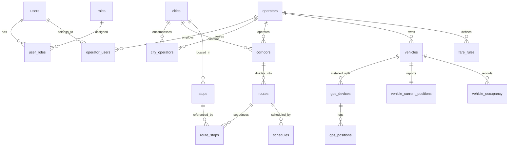

# BusWatch — Database Schema Documentation

> **Sprint:** 002 — Technical Foundation  
> **Database:** PostgreSQL 15 + PostGIS 3.4  
> **ORM:** Prisma 5.17  
> **Last Updated:** 2026-11-13  

---

## 1. Desain & Prinsip Utama

1. **UUID sebagai Primary Key**: Seluruh tabel menggunakan UUID v4 (`@id @default(uuid()) @db.Uuid`) untuk menjamin keamanan dari id enumeration attack dan kemudahan sinkronisasi data antar node / environment.
2. **Multi-City & Multi-Operator**:
   - Satu kota dapat dilayani oleh banyak operator.
   - Satu operator dapat beroperasi di lebih dari satu kota.
   - Relasi dihubungkan melalui tabel relasi many-to-many `city_operators`.
3. **Pemisahan Koridor dan Rute**:
   - `corridors`: Layanan transportasi secara makro (contoh: *Koridor 1 Poltrada–Ubung–Puputan*).
   - `routes`: Rute fisik dengan arah perjalanan spesifik (`OUTBOUND` atau `INBOUND`).
   - `route_stops`: Urutan halte yang dilalui pada rute tersebut dengan kolom `stop_order` dan jarak/waktu kumulatif.
4. **Pemisahan Riwayat GPS dan Posisi Terkini**:
   - `gps_positions`: Tabel append-only (hanya *insert*, tidak pernah *update*) untuk audit, replay perjalanan, dan kalkulasi analitik.
   - `vehicle_current_positions`: Tabel 1-to-1 dengan kendaraan untuk pembacaan real-time berkecepatan tinggi oleh antarmuka live tracking. Diperbarui secara selektif hanya jika timestamp baru > timestamp lama untuk menghindari *out-of-order packet issue*.
5. **Kategori Data GPS**:
   - Kolom `source`: Membedakan `ACTUAL` (data dari GPS fisik) dan `SIMULATED` (data simulasi demo).
   - Kolom `quality`: Mengindikasikan kualitas sinyal (`GOOD`, `DEGRADED`, `POOR`).
6. **Isolasi Data Antar-Operator**:
   - Setiap tabel armada dan operasional menyertakan `operator_id`.
   - Akses dibatasi pada level service layer/API dengan memvalidasi kepemilikan operator melalui tabel `operator_users`.

---

## 2. Diagram Konseptual Relasi Entitas (ERD)



---

## 3. Rincian Entitas & Kolom

### A. Auth & RBAC

#### `users`
| Kolom | Tipe | Constraint | Deskripsi |
|---|---|---|---|
| `id` | UUID | PK | ID unik pengguna |
| `email` | VARCHAR(255) | UNIQUE, NOT NULL | Alamat email terdaftar |
| `password_hash` | VARCHAR(255) | NOT NULL | Hash kata sandi (Argon2 / Bcrypt) |
| `name` | VARCHAR(255) | NOT NULL | Nama lengkap pengguna |
| `phone` | VARCHAR(50) | NULL | Nomor kontak |
| `is_active` | BOOLEAN | DEFAULT true | Status keaktifan akun |
| `created_at` | TIMESTAMPTZ | DEFAULT now() | Waktu pendaftaran |
| `updated_at` | TIMESTAMPTZ | AUTO UPDATE | Waktu pembaruan profil |

#### `roles`
| Kolom | Tipe | Constraint | Deskripsi |
|---|---|---|---|
| `id` | UUID | PK | ID unik role |
| `name` | VARCHAR(50) | UNIQUE, NOT NULL | Nama role: `SUPER_ADMIN`, `OPERATOR_ADMIN`, `OPERATOR_STAFF`, `PASSENGER`, `GOVERNMENT` |
| `description` | VARCHAR(255) | NULL | Deskripsi kewenangan role |
| `created_at` | TIMESTAMPTZ | DEFAULT now() | Waktu pembuatan |

#### `user_roles`
| Kolom | Tipe | Constraint | Deskripsi |
|---|---|---|---|
| `user_id` | UUID | FK -> `users.id`, PK (composite) | ID pengguna |
| `role_id` | UUID | FK -> `roles.id`, PK (composite) | ID role yang diberikan |
| `granted_at` | TIMESTAMPTZ | DEFAULT now() | Waktu pemberian hak akses |

---

### B. Pengelolaan Wilayah & Operator

#### `cities`
| Kolom | Tipe | Constraint | Deskripsi |
|---|---|---|---|
| `id` | UUID | PK | ID kota |
| `name` | VARCHAR(255) | NOT NULL | Nama kota (contoh: Denpasar, Singaraja) |
| `province` | VARCHAR(255) | NOT NULL | Nama provinsi (contoh: Bali) |
| `country` | VARCHAR(100) | DEFAULT 'Indonesia' | Negara |
| `lat` | DOUBLE PRECISION | NOT NULL | Titik koordinat pusat (Latitude) |
| `lng` | DOUBLE PRECISION | NOT NULL | Titik koordinat pusat (Longitude) |
| `is_active` | BOOLEAN | DEFAULT true | Status operasional wilayah |
| `created_at` | TIMESTAMPTZ | DEFAULT now() | Waktu dibuat |
| `updated_at` | TIMESTAMPTZ | AUTO UPDATE | Waktu diperbarui |

*Unique constraint:* `(name, province)`

#### `operators`
| Kolom | Tipe | Constraint | Deskripsi |
|---|---|---|---|
| `id` | UUID | PK | ID operator |
| `name` | VARCHAR(255) | NOT NULL | Nama operator penyedia bus |
| `code` | VARCHAR(20) | UNIQUE, NOT NULL | Kode singkatan operator (contoh: `BWBALI`) |
| `contact_email` | VARCHAR(255) | NULL | Email operasional |
| `contact_phone` | VARCHAR(50) | NULL | Nomor telepon operasional |
| `address` | TEXT | NULL | Alamat kantor operator |
| `is_active` | BOOLEAN | DEFAULT true | Status lisensi operasional |
| `created_at` | TIMESTAMPTZ | DEFAULT now() | Waktu dibuat |
| `updated_at` | TIMESTAMPTZ | AUTO UPDATE | Waktu diperbarui |

#### `city_operators`
Tabel relasi *many-to-many* antara kota dan operator.
| Kolom | Tipe | Constraint | Deskripsi |
|---|---|---|---|
| `city_id` | UUID | FK -> `cities.id`, PK (composite) | ID kota |
| `operator_id` | UUID | FK -> `operators.id`, PK (composite) | ID operator |
| `since` | TIMESTAMPTZ | DEFAULT now() | Tanggal mulai operasi di kota tsb |

#### `operator_users`
Menentukan pengguna mana yang terafiliasi dengan operator tertentu.
| Kolom | Tipe | Constraint | Deskripsi |
|---|---|---|---|
| `operator_id` | UUID | FK -> `operators.id`, PK (composite) | ID operator |
| `user_id` | UUID | FK -> `users.id`, PK (composite) | ID pengguna |
| `role` | VARCHAR(50) | DEFAULT 'STAFF' | Peran internal: `ADMIN`, `STAFF`, `DRIVER` |
| `joined_at` | TIMESTAMPTZ | DEFAULT now() | Tanggal bergabung |

---

### C. Jaringan Transportasi (Network)

#### `corridors`
| Kolom | Tipe | Constraint | Deskripsi |
|---|---|---|---|
| `id` | UUID | PK | ID koridor |
| `city_id` | UUID | FK -> `cities.id` | Kota tempat koridor beroperasi |
| `operator_id` | UUID | FK -> `operators.id` | Operator pemilik izin trayek |
| `name` | VARCHAR(255) | NOT NULL | Nama koridor (contoh: Koridor 1) |
| `code` | VARCHAR(20) | NOT NULL | Kode koridor (contoh: K1) |
| `color` | VARCHAR(7) | DEFAULT '#1677f9' | Kode warna identifikasi (HEX) |
| `description` | TEXT | NULL | Keterangan rute utama |
| `is_active` | BOOLEAN | DEFAULT true | Status operasional |
| `created_at` | TIMESTAMPTZ | DEFAULT now() | Waktu dibuat |
| `updated_at` | TIMESTAMPTZ | AUTO UPDATE | Waktu diperbarui |

*Unique constraint:* `(city_id, code)`

#### `routes`
| Kolom | Tipe | Constraint | Deskripsi |
|---|---|---|---|
| `id` | UUID | PK | ID rute |
| `corridor_id` | UUID | FK -> `corridors.id` (CASCADE) | ID koridor induk |
| `name` | VARCHAR(255) | NOT NULL | Nama arah (contoh: Poltrada -> Ubung) |
| `direction` | VARCHAR(20) | DEFAULT 'OUTBOUND' | Arah: `OUTBOUND` (pergi) / `INBOUND` (pulang) |
| `is_active` | BOOLEAN | DEFAULT true | Status rute |
| `created_at` | TIMESTAMPTZ | DEFAULT now() | Waktu dibuat |
| `updated_at` | TIMESTAMPTZ | AUTO UPDATE | Waktu diperbarui |

#### `stops`
| Kolom | Tipe | Constraint | Deskripsi |
|---|---|---|---|
| `id` | UUID | PK | ID fisik halte |
| `city_id` | UUID | FK -> `cities.id` | Wilayah kota halte berada |
| `name` | VARCHAR(255) | NOT NULL | Nama halte (contoh: Halte Ubung) |
| `code` | VARCHAR(20) | NULL | Kode resmi halte |
| `subtitle` | VARCHAR(255) | NULL | Penunjuk lokasi/jalan |
| `lat` | DOUBLE PRECISION | NOT NULL | Posisi Latitude |
| `lng` | DOUBLE PRECISION | NOT NULL | Posisi Longitude |
| `type` | VARCHAR(30) | DEFAULT 'BUS_STOP' | Tipe: `BUS_STOP`, `TERMINAL`, `INTERCHANGE` |
| `is_active` | BOOLEAN | DEFAULT true | Status ketersediaan halte |
| `created_at` | TIMESTAMPTZ | DEFAULT now() | Waktu dibuat |
| `updated_at` | TIMESTAMPTZ | AUTO UPDATE | Waktu diperbarui |

#### `route_stops`
Menghubungkan halte dengan rute dalam urutan tertentu.
| Kolom | Tipe | Constraint | Deskripsi |
|---|---|---|---|
| `route_id` | UUID | FK -> `routes.id` (CASCADE), PK | ID rute |
| `stop_id` | UUID | FK -> `stops.id` (RESTRICT), PK | ID halte |
| `stop_order` | INT | NOT NULL | Nomor urut pemberhentian (1, 2, 3...) |
| `distance_km` | DOUBLE PRECISION | NULL | Jarak kumulatif dari titik awal (km) |
| `duration_min` | INT | NULL | Estimasi waktu tempuh dari titik awal (menit) |

*Unique constraint:* `(route_id, stop_order)`

---

### D. Armada & GPS Tracking

#### `vehicles`
| Kolom | Tipe | Constraint | Deskripsi |
|---|---|---|---|
| `id` | UUID | PK | ID kendaraan |
| `operator_id` | UUID | FK -> `operators.id` | Operator pemilik bus |
| `plate_number` | VARCHAR(20) | UNIQUE, NOT NULL | Nomor polisi armada (contoh: DK-1234-BW) |
| `model` | VARCHAR(100) | NULL | Merk & tipe sasis/karoseri |
| `capacity` | INT | DEFAULT 40 | Kapasitas penumpang total |
| `is_active` | BOOLEAN | DEFAULT true | Status kelayakan operasi |
| `created_at` | TIMESTAMPTZ | DEFAULT now() | Waktu registrasi armada |
| `updated_at` | TIMESTAMPTZ | AUTO UPDATE | Waktu perubahan data |

#### `gps_devices`
| Kolom | Tipe | Constraint | Deskripsi |
|---|---|---|---|
| `id` | UUID | PK | ID modul GPS |
| `vehicle_id` | UUID | FK -> `vehicles.id` (CASCADE) | Kendaraan yang dipasangi GPS |
| `serial` | VARCHAR(100) | UNIQUE, NOT NULL | Serial number IMEI / hardware ID |
| `model` | VARCHAR(100) | NULL | Merk/tipe perangkat tracker |
| `is_active` | BOOLEAN | DEFAULT true | Status alat |
| `created_at` | TIMESTAMPTZ | DEFAULT now() | Waktu dipasang |

#### `gps_positions` *(Append-Only History)*
| Kolom | Tipe | Constraint | Deskripsi |
|---|---|---|---|
| `id` | UUID | PK | ID log posisi |
| `device_id` | UUID | FK -> `gps_devices.id` | ID perangkat pengirim |
| `lat` | DOUBLE PRECISION | NOT NULL | Latitude |
| `lng` | DOUBLE PRECISION | NOT NULL | Longitude |
| `speed` | DOUBLE PRECISION | NULL | Kecepatan bus (km/jam) |
| `heading` | DOUBLE PRECISION | NULL | Arah kompas bus (0 - 360 derajat) |
| `accuracy` | DOUBLE PRECISION | NULL | Akurasi estimasi sinyal (meter) |
| `altitude` | DOUBLE PRECISION | NULL | Ketinggian di atas permukaan laut (meter) |
| `source` | VARCHAR(20) | DEFAULT 'ACTUAL' | Sumber data: `ACTUAL` atau `SIMULATED` |
| `quality` | VARCHAR(20) | DEFAULT 'GOOD' | Kondisi sinyal: `GOOD`, `DEGRADED`, `POOR` |
| `timestamp` | TIMESTAMPTZ | NOT NULL | Waktu titik koordinat direkam perangkat |
| `created_at` | TIMESTAMPTZ | DEFAULT now() | Waktu paket koordinat diterima server |

*Index:* `(device_id, timestamp DESC)`

#### `vehicle_current_positions` *(Real-Time Snapshot)*
| Kolom | Tipe | Constraint | Deskripsi |
|---|---|---|---|
| `vehicle_id` | UUID | FK -> `vehicles.id`, PK | ID kendaraan |
| `lat` | DOUBLE PRECISION | NOT NULL | Latitude terakhir |
| `lng` | DOUBLE PRECISION | NOT NULL | Longitude terakhir |
| `speed` | DOUBLE PRECISION | NULL | Kecepatan terakhir (km/jam) |
| `heading` | DOUBLE PRECISION | NULL | Arah terakhir (0 - 360 derajat) |
| `source` | VARCHAR(20) | DEFAULT 'ACTUAL' | `ACTUAL` atau `SIMULATED` |
| `last_timestamp` | TIMESTAMPTZ | NOT NULL | Waktu GPS terakhir yang diterima |
| `updated_at` | TIMESTAMPTZ | AUTO UPDATE | Waktu snapshot diperbarui |

---

### E. Jadwal, Okupansi & Tarif

#### `schedules`
| Kolom | Tipe | Constraint | Deskripsi |
|---|---|---|---|
| `id` | UUID | PK | ID jadwal |
| `route_id` | UUID | FK -> `routes.id` (CASCADE) | Rute yang dijadwalkan |
| `start_time` | VARCHAR(5) | NOT NULL | Jam mulai operasional ("05:30") |
| `end_time` | VARCHAR(5) | NOT NULL | Jam akhir operasional ("22:00") |
| `frequency_min` | INT | NOT NULL | Waktu antara (headway) armada (menit) |
| `operating_days` | TEXT[] | NOT NULL | Hari beroperasi (`["MON", "TUE", ...]`) |
| `is_active` | BOOLEAN | DEFAULT true | Status jadwal |
| `created_at` | TIMESTAMPTZ | DEFAULT now() | Waktu dibuat |
| `updated_at` | TIMESTAMPTZ | AUTO UPDATE | Waktu diperbarui |

#### `vehicle_occupancy` *(Append-Only Log)*
| Kolom | Tipe | Constraint | Deskripsi |
|---|---|---|---|
| `id` | UUID | PK | ID log okupansi |
| `vehicle_id` | UUID | FK -> `vehicles.id` (CASCADE) | ID kendaraan |
| `occupancy_pct` | DOUBLE PRECISION | NOT NULL | Persentase keterisian (0.0 - 100.0) |
| `passenger_count`| INT | NULL | Jumlah aktual penumpang di dalam bus |
| `source` | VARCHAR(20) | DEFAULT 'MANUAL' | Sumber: `SENSOR`, `MANUAL`, `SIMULATED` |
| `recorded_at` | TIMESTAMPTZ | NOT NULL | Waktu pengukuran |
| `created_at` | TIMESTAMPTZ | DEFAULT now() | Waktu data dicatat |

*Unique constraint:* `(vehicle_id, recorded_at)`  
*Index:* `(vehicle_id, recorded_at DESC)`

#### `fare_rules`
| Kolom | Tipe | Constraint | Deskripsi |
|---|---|---|---|
| `id` | UUID | PK | ID aturan tarif |
| `city_id` | UUID | NOT NULL | Kota berlakunya tarif |
| `operator_id` | UUID | FK -> `operators.id` | Operator pemilik kebijakan |
| `corridor_id` | UUID | NULL | Koridor tertentu (NULL jika tarif seragam) |
| `base_fare` | DOUBLE PRECISION | NOT NULL | Tarif dasar (contoh: 4400 / 5000) |
| `per_km_rate` | DOUBLE PRECISION | DEFAULT 0 | Tarif per km (0 untuk tarif flat) |
| `currency` | VARCHAR(5) | DEFAULT 'IDR' | Mata uang |
| `valid_from` | TIMESTAMPTZ | NOT NULL | Tanggal mulai berlaku |
| `valid_until` | TIMESTAMPTZ | NULL | Tanggal akhir berlaku (NULL = permanen) |
| `is_active` | BOOLEAN | DEFAULT true | Status keaktifan tarif |
| `created_at` | TIMESTAMPTZ | DEFAULT now() | Waktu dibuat |
| `updated_at` | TIMESTAMPTZ | AUTO UPDATE | Waktu diperbarui |

---

## 4. Mekanisme PostGIS & Spatial Query

Prisma ORM menangani relasi dan skema relasional standar. Untuk query geospasial performa tinggi (seperti pencarian halte terdekat dengan radius atau pengecekan bus dalam buffer lintasan koridor), digunakan `prisma.$queryRaw`:

Contoh query PostGIS:
```sql
-- Mencari halte terdekat dalam radius 1.5 km dari koordinat pengguna
SELECT 
    id, name, lat, lng,
    ST_Distance(
        ST_SetSRID(ST_MakePoint(lng, lat), 4326)::geography,
        ST_SetSRID(ST_MakePoint($1, $2), 4326)::geography
    ) AS distance_meters
FROM stops
WHERE ST_DWithin(
    ST_SetSRID(ST_MakePoint(lng, lat), 4326)::geography,
    ST_SetSRID(ST_MakePoint($1, $2), 4326)::geography,
    1500
)
ORDER BY distance_meters ASC
LIMIT 5;
```
