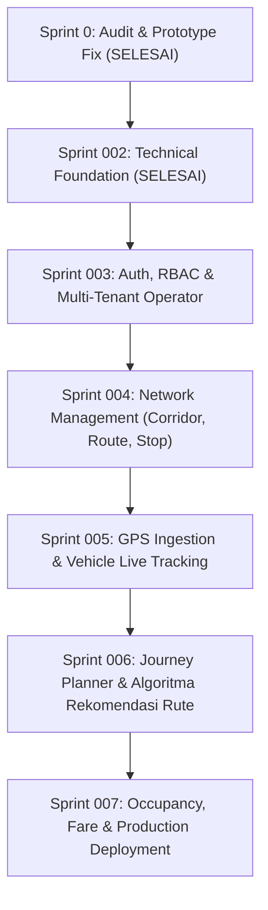

# BusWatch — Migration Plan: Prototype to Next.js Modular Monolith

> **Sprint:** 002 — Technical Foundation  
> **Source:** Static Prototype (`index.html`, `app.js`, `styles.css`)  
> **Target:** Next.js 14 (App Router) + TypeScript + Prisma + PostgreSQL/PostGIS  
> **Last Updated:** 2026-11-13  

---

## 1. Strategi & Prinsip Migrasi

Migrasi dilakukan dengan prinsip **Non-Destructive & Iterative Refactoring**:
1. **Zero Disruption to Existing Prototype**: Berkas prototype lama disimpan utuh pada direktori `prototype/` dan root agar tetap dapat didemokan secara instan kapan saja melalui web browser.
2. **Data-First Transformation**: Semua konstanta hard-coded pada `app.js` (`BALI_COORDINATES`, `STOPS_DATA`, `CORRIDOR_DATA`, `destData`, `POPULAR_LOCATIONS`) dimodelkan ke dalam database relational PostGIS dan dikonversi menjadi data seed yang konsisten.
3. **No Direct Cut-over**: Komponen UI tidak disalin mentah-mentah sekaligus. Komponen dipecah menjadi modul kecil yang dapat diuji independen (misalnya: Peta Leaflet -> Form Autocomplete -> Card KPI -> Tabel Jadwal).
4. **Authentic Data Integrity**: Tidak ada data simulasi yang disamarkan sebagai data aktual. Setiap titik peta demo diberi label visual `DEMO` secara tegas.

---

## 2. Pemetaan Komponen Prototype ke Arsitektur Baru

| Bagian Prototype Lama | Implementasi Baru pada Next.js | Status Migrasi |
|---|---|---|
| **Struktur HTML Multi-Page** (`index.html`, `planner.html`, `tracking.html`, dsb.) | Next.js App Router: `src/app/page.tsx`, `src/app/planner/page.tsx`, `src/app/tracking/page.tsx` | Kerangka & Dashboard siap (Sprint 002); Halaman lainnya pada sprint berikutnya |
| **Peta Gabungan Leaflet & Google Map Layers** (`app.js` lines 163-319) | Reusable Client Component `src/components/map/BuswatchMap.tsx` dengan OpenStreetMap murni dan penanganan Leaflet SSR | Siap (Sprint 002) |
| **Data Koridor & Halte Hard-coded** (`app.js` lines 21-86) | Skema database PostgreSQL/PostGIS (`corridors`, `routes`, `stops`, `route_stops`) dan seed data `prisma/seed.ts` | Siap (Sprint 002) |
| **Simulasi Pergerakan Bus Interval** (`app.js` lines 321-365) | Domain service `src/modules/gps/` dengan pemisahan tabel `gps_positions` (history) dan `vehicle_current_positions` (snapshot) | Fondasi skema siap; Event bus/WebSocket pada sprint tracking |
| **Autocomplete Geocoding Nominatim/Photon** (`app.js` lines 70-160) | Server-side API endpoint proxy `/api/geocoding/search` di Next.js untuk mencegah CORS & pembatasan kuota client | Rencana Sprint 5 (Journey Planner) |
| **Kalkulator Rute Cepat** (`app.js` `updateTrip()`) | Modul algoritma transit pada `src/modules/planner/` yang menghitung walk-to-stop, in-vehicle time, dan transfer | Rencana Sprint 5 (Journey Planner) |
| **Sistem CSS Global** (`styles.css` 125 rules) | Tailwind CSS terkonfigurasi dengan variabel warna brand (`navy`, `buswatch-blue`, `buswatch-teal`) di `tailwind.config.ts` | Siap (Sprint 002) |

---

## 3. Rencana Eksekusi Berdasarkan Sprint

### Detail Aktivitas per Sprint Mendatang:
- **Sprint 003 (Auth & Multi-Tenant)**:
  - Implementasi NextAuth.js / session JWT.
  - Otorisasi berbasis role (`SUPER_ADMIN`, `OPERATOR_ADMIN`, `OPERATOR_STAFF`, `PASSENGER`, `GOVERNMENT`).
  - Isolasi data per operator ID pada seluruh query database.
- **Sprint 004 (Network Management)**:
  - CRUD API koridor, rute, dan halte.
  - Visualisasi polyline rute aktual dari koordinat PostGIS.
- **Sprint 005 (GPS & Telemetri)**:
  - Ingest API untuk perangkat GPS tracker.
  - WebSocket / Server-Sent Events (SSE) untuk update realtime armada di peta.
- **Sprint 006 (Journey Planner)**:
  - Migrasi menyeluruh form input asal-tujuan dengan geocoding dan autocomplete.
  - Perhitungan rute kombinasi jalan kaki dan bus transit.
- **Sprint 007 (Finalisasi MVP)**:
  - Pengujian end-to-end, load testing, hardening keamanan, dan deployment staging.
